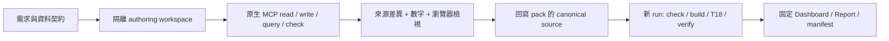

# Agent、Studio 與 Chat — 0.12 更新後的方向

兩條路都做得到，但現在可用的是原生 authoring 工具與可驗證交付管線，尚未實作面向客戶的生成產品。S1 的原則是讓 odsh 的殼變薄：不要再包一套通用編輯器、query API 或 MCP 工具集。

更新：2026-10-30。已推送 Pages 的是 energy 靜態成品，並未因此部署原生 MCP、Studio 或模型服務；o11y 仍為本機合成案例。發布事實見 [deployment](deployment.md)，文件入口見 [索引](README.md)。

## 已有能力與邊界

| 元件 | 目前狀態 |
|---|---|
| 原生 CLI | build、check --all-params、lint、charts、upgrade 已接入 |
| 原生 MCP | 套件已安裝；實測工具列表 27 個、list/read/check_dashboard；原生 write 支援 expected hash 防止覆寫並行變更 |
| Native dev --mcp | odsh dev 直接啟動原生 authoring runtime，沒有私有 HTTP adapter |
| Native serve | 實測唯讀 UI 與即時 DuckDB filter；不提供原生編輯 UI |
| Native render_panel | 已在工具列；瀏覽器套件下載被環境網路規則阻擋，尚未實測呼叫 |
| odsh 品質 | 原生 expect + 少量 Prose lint；沒有舊的 boundedValidation callback runner |
| Pack / run / brand | 已實作；domain hook 不進 core；新 run 固定輸入與模板 |
| TD options | 從 metrics/native charts/distinct 產生；字母穩定、內容版本、過多值需縮小 |
| Studio / chat authoring | 帳號、權限、隔離草稿、模型工作佇列、revision 審查與發布尚未實作 |

原生讀者聊天助手、原生 MCP authoring agent、energy 個人排版，是不同功能。靜態成品可以改篩選與個人排版；它不會執行任意新 SQL 或寫入新的正式 widget。

## 1. Developer 用 agent 產生固定成品

現在開發者即可連接原生 MCP，在草稿副本讀資料契約、查欄位、改 TSX／SQL、跑 `check_dashboard(all_params:true)`。使用 `read_dashboard` 取得 hash，再以 `write_dashboard_file(expected:hash)` 更新，避免覆蓋其他改動。視覺驗證可使用原生 render_panel（環境就緒後），不應另造通用 renderer。

odsh 需要的下一層僅是 job/revision orchestration：配置模型、限定 workspace 與資料來源、記錄 tool calls/findings、限制重試次數，再把核准 revision 交給既有 run builder。**原生 MCP 可寫檔不等於本 repo 已自動呼叫模型修復。** 已刪除未接入模型的 callback，避免誤導。

能源頁面部分由 `packs/energy/hooks/layouts.mjs`／`report-layout.mjs` 產生，修改 generated workspace 後須回寫這些 canonical sources。直接重跑 `prepareWorkspace` 會覆蓋草稿；S2 要把 authoring draft 與 frozen release 明確分開。

## 2. Customer 用 Studio／Chat 產生新成品

建議讓 UI 輸出受限意圖，不直接讓客戶提供任意 SQL／TSX。先選租戶授權的 pack/view、measure、dimension、grain、widget，再以 `options_version` 檢查選項是否過期。資料維度超過 26 項時引導縮小範圍；不要把 letter 當成永久、跨版本的語意 ID。

例：客戶要求「看 checkout 的錯誤率與 p99 趨勢，做一張週報」。Studio 或 Chat 收斂成明確 spec，server 檢查租戶、資料範圍及可用元件；隔離 worker 使用原生 authoring 工具建立草稿，回傳來源差異、資料驗證與預覽。客戶確認的是該 revision；發布前再次核對 hash，再建新 run。

要補的服務依序為：

1. 登入與租戶資料範圍，workspace/process 隔離；權限在查詢前執行，不能靠 browser filters。
2. 受限 spec/compiler（S2），編譯到原生 SQL/TSX；重用原生 chart catalog 與 pack metrics。
3. 有工作狀態、取消、資源上限與有限修復的 job worker；不是把 dev --mcp 直接公開到網際網路。
4. draft/revision/preview 與審查後發布；驗證、預覽與發布同一份內容。
5. 再加 UI 的版面操作與 chat；公司共用版型、跨裝置個人設定接同一版本儲存。

這些是產品服務，不需要 fork open-dashboard。Rill 可當額外指標探索入口，需實際 runtime、更新與權限串接；它不負責取代 report 交付或模型工作佇列。ClickHouse 屬後續資料來源路線，S1 沒有完成生產連線。

## 部署

靜態 Dashboard/Report 只需 HTTP hosting。Studio frontend 可用 Vercel／Cloudflare；Node/DuckDB/MCP/Playwright 長任務放在支援原生模組與持久工作目錄的獨立 worker。未來 Production gateway 需提供認證、租戶路由、TLS、限制與 job API；不依賴 `/__odd/api/*` 私有路由。

先完成一個真實資料、單租戶、有審查與可追溯 artifact 的 developer agent 閉環，再開放 customer authoring。S1 嚴格缺口與測試邊界見 [handoff](../handoff.md) 和 [validation](validation.md)。
