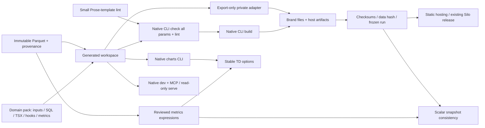

# Architecture — S1, open-dashboard 0.12.0

Updated 2026-10-30. [Documentation index](README.md) · [Publication contract](deployment.md) · [Validation evidence](validation.md).

`src/` and `td/` are domain-neutral, guarded by T19. Packs own domain data, semantics, charts, branding and optional generation hooks. Adding `packs/o11y` required zero core changes in W4; hashes captured in `docs/s1/w4-evidence.json` prove that boundary. `charts/prose` is the shared `defineChart` extension.

The public integration surface is CLI, MCP, config, component props, query headers, static build output and documented host embedding. `/__odd/api/*` is not an integration contract. `upstream.mjs` centralizes the only production private import: three export-only symbols required by 0.12. This is an explicit exception and a strict S1 gap, not a public API claim.

`dev --mcp` provides authoring; `serve` executes live read-only queries; built snapshots require only static HTTP or single HTML. MCP is an authoring tool surface, not authentication or customer authorization. The energy personal-layout wrapper remains a pack-specific reader extension; it does not duplicate a shared runtime editor.

## Frozen-run contract

Each run stores `input/`, `generation.json`, generated `workspace/`, `build/site/`, `build/{dashboard,report,report-native}.html`, checks, native lint and `manifest.json`. `rill/`, `consistency.json` and `validation/` are separate derived outputs. No separate custom `quality.json` runner remains.

Build uses a lock and staging directory; successful output atomically replaces the previous build. Existing input/template hash changes are rejected. Pack database.md files are included in the template fingerprint, so documentation edits there also require a new run ID for rebuilding. Previously built artifacts remain valid and publishable. Workspace preparation is generated and may replace local edits: promote authored changes to pack source and create a new run; do not use a frozen run as a long-lived draft database.

`data_hash` covers canonical site JSON, retaining row order and freshness. Only runtime `ranAt`/`elapsedMs` and the top-level dashboard index `builtAt` are excluded from that hash. The written `dashboards.json` preserves `builtAt` for the host; complete byte hashes cover artifacts. Full HTML byte equality is not promised. DuckDB uses threads=1 and config timeZone=Asia/Taipei. Manifest includes source commit and dirty flag; template SHA is authoritative for generated source bytes.

Native `check --all-params` and `lint --json` run before build, with the pack's maxRuns (default 100). Query errors, row truncation and check sweep trimming are blocking. All declared shared energy quality queries are referenced by a validation-only dashboard, because upstream does not execute unused shared queries. That dashboard is omitted from delivered output. `quality.passed` counts default-query expectation results; it is not a count of all sweep combinations.

## Semantics and delivery

Energy creates six sites × 92 days × 96 intervals = 52,992 rows, plus 220,800 subsystem telemetry rows and dimensions/events. Three customer runs physically contain only the respective two sites. Browser filters are not authorization. o11y produces 120,960 requests over 14 days, three services, 40 endpoints and an injected checkout incident; synthetic provenance remains visible.

Reviewed metrics are pack files. T18 evaluates expressions against raw immutable Parquet, parameterizes derived macros, and compares independently authored `-- metric: view.measure` queries in the delivered snapshot. Scope is full input, one-row references, all measures covered; arbitrary filter scopes remain future work. Numeric tolerance is relative 1e-9; NULL must match NULL. Rill export checks input/template hashes and copies sources plus reviewed metrics, without draft aggregates.

TD letters persist across additions/removals; retired letters are not reused. Slots exceeding 26 values or exhausting their historical letters require narrowing. Native widgets are additionally grouped by native chart group. `options_version` hashes content, metric definition and chart catalog, with no wall clock. `thresholds.lock.json` remains empty; this does not implement S2 compiler or S3 threshold calibration.

Brand CSS is isolated. imitator report.css is original, byte-hashed and inline; mappings use `overrides.css`. Native DOM selectors are a presentation compatibility seam and require browser regression on upgrades. Energy Loop preserves #0087dc, teal and lime, with explicit light/dark contrast.

Existing Silo release isolation/checksums remain, without new auth/multitenant runtime. Following the user’s publication request, S1 energy reader artifacts were pushed to gh-pages using exactly the prior v4 inputs. The public bundle contains three customers, six sites and a synthetic portfolio; o11y is not included. Branch contents were verified; github.io availability remains unconfirmed because the environment proxy blocks that host. See deployment.md for the distinction between frozen runs and the replaceable public demo URLs. Published artifacts exclude Parquet, SQL, credentials and source workspaces. Rill runtime and ClickHouse production connection are not provisioned by this change.
